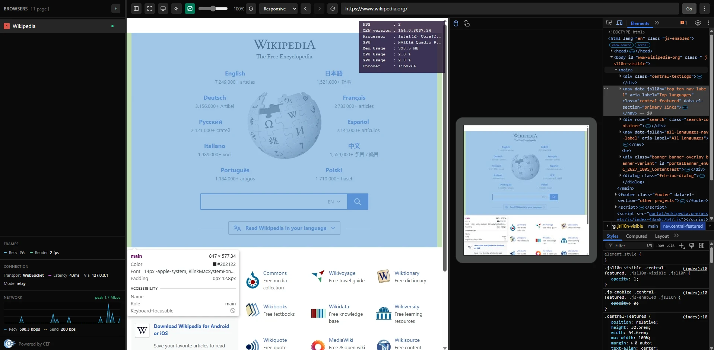
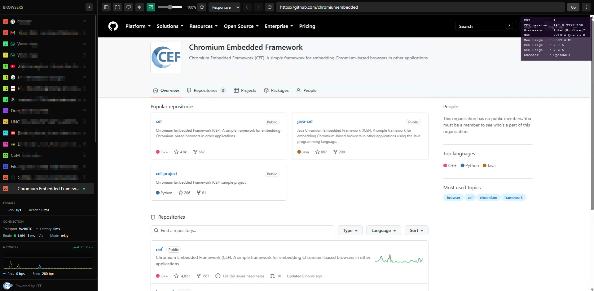

# CEF As Service

**Chromium as a service.** Run real Chromium (CEF) browsers on a Windows or Linux server and stream them to any
web browser. A **Broker** gives each client its own headless browser worker
and relays video, audio and input over **WebSocket** or **WebRTC**. A small **Admin** web app manages it all.

```
 ┌──────────────┐   WebSocket / WebRTC    ┌──────────┐ WebSocket ┌─────────────────────┐
 │ Any browser  │ ◄─────────────────────► │  Broker  │ ◄───────► │ Worker (CEF, OSR)   │ × N
 │ (viewer page)│   video · audio · input │          │           │ one per session     │
 └──────────────┘                         └────▲─────┘           └─────────────────────┘
                                               │ loopback control channel
                                          ┌────┴─────┐
                                          │  Admin   │  settings · workers · encoders
                                          └──────────┘
```

## Features

- **One real Chromium per client.** Each session runs in its own worker process and uses Chromium's own user agent.
- **Two transports:** WebSocket (JPG frames or encoded video) and WebRTC (video + Opus audio, TURN-ready).
- **Multi-account isolation:** by default, each tenant gets one persistent browser context. With `--isolation-mode-session`, every tab gets its own context, so you can run several logins to the same site side by side.
- **Sessions that survive:** configurable session timeout and manifest TTL, last-URL restore, and logins kept across Broker restarts.
- **Full interaction:** mouse, keyboard, touch and on-screen keyboard (Android), popups. Phones get a mobile viewer page automatically.
- **Mobile device mode:** Chrome DevTools' device list (iPhone, Pixel, Galaxy, iPad, foldables and more) with the device's user agent, Client Hints and touch, rotation and device zoom.
- **Session recording:** record a tab to MP4 (video) or MP3 (audio only) and download it when you stop. The recording feature only works on non-sensitive sites; otherwise, the recording is blocked.
- **DevTools in the viewer:** Chromium's own DevTools for each tab, in a resizable side panel (off by default, switched on in Admin).
- **Drag and drop inside the page:** with a drag preview that follows the pointer; a link dropped on the address bar or the sidebar opens it.
- **Pluggable video encoders:** loaded from `plugins/encoders/`. Two plugins are included: **VP9** (libvpx, ready to use) and **OpenH264** (the codec itself is a one-click download from Cisco, see below). The built-in format is JPG.
- **Proxy:** one proxy table in Admin (HTTP, HTTPS, SOCKS5), switched on and off with one switch. *Global* sends every session through the row the admin picks; *Manual* lets the viewer user pick a row, and with `--isolation-mode-session` each new tab asks again. Pages opened from a tab use its proxy. Logins stay on the server; the viewer only sees labels.
- **Browsing filter:** the remote browser can't reach CAS's own ports, `file:` or a Deny list (HTTP 403), with an Allow list and a log of what would be blocked.
- **Admin web UI:** password-protected and loopback-only. Start/stop/restart the Broker, view live workers (OS, client IP, created), and manage encoder settings, session timeout, default URL and executables.





How it fits together - processes, tenants, isolation modes, transports and connection modes, with diagrams: **[How CAS works](docs/how-it-works.md)**.

## Quick start (release build)

▶ **[Watch the setup video](https://www.youtube.com/watch?v=_qDP13IAnvg)**

1. Download the latest zip from [**Releases**](https://github.com/marman-hp/CefAsService/releases) (CEF included) and extract it to a folder you can write to, e.g. `C:\CefAsService` (not `C:\Program Files`, see [Running on Windows](#running-on-windows)).
2. Run `Admin\Xilium.CefGlue.Broker.Admin.exe`.
3. Open **http://localhost:57402**, create the admin password and press **Start**.
4. Clients open **`https://<host>:57443/broker`**. On a LAN you'll see a one-time warning for the self-signed certificate.
5. For video (required for WebRTC), pick an encoder in **Admin → Encoder Settings**, then Restart: **vp9** works right away; for H.264, **openh264 → *Download from Cisco*** first.
6. To stop everything, press **Ctrl+C** in the Admin console window. The Broker and all workers run in that window and stop with it.

The release is self-contained: no .NET installation is needed. Its `README.txt` lists every port and
first-run prompt.

## Hardware

- **CPU (server):** OpenH264 and VP9 are software encoders, so video encoding runs entirely on the CPU and
  each streaming session runs its own encoder. From our testing: **6 cores minimum, 8 or more
  recommended**, more for several sessions at once or high resolutions. The encoder uses up to
  `min(cores, 8)` threads by default, VP9 up to `min(cores, 6)` (Encoder Settings → *Thread cap*).
  JPG mode needs no video encoder but still costs CPU per frame.
- **GPU (server):** not needed. *Disable GPU* is on by default.
- **Viewer (client):** a browser with hardware H.264 decoding (any normal PC or phone) gives the
  smoothest picture. In a VM or on a machine without a GPU, the browser decodes in software: it
  still works, just slower.

## Build from source

Requirements: **Windows x64**, **.NET 10 SDK**.

CEF version: **154.0.33+ga03e714+chromium-154.0.8037.94** (Chromium 154), Windows 64-bit *minimal* distribution.

`get-cef.ps1` downloads it for you automatically. To download it manually, get:

[cef_binary_154.0.33+ga03e714+chromium-154.0.8037.94_windows64_minimal.tar.bz2](https://cef-builds.spotifycdn.com/cef_binary_154.0.33%2Bga03e714%2Bchromium-154.0.8037.94_windows64_minimal.tar.bz2)

The archive is about 165 MB. All CEF builds are available at
[cef-builds.spotifycdn.com](https://cef-builds.spotifycdn.com/index.html).

Then pass the downloaded archive to `get-cef.ps1`:

```powershell
.\get-cef.ps1 -FromArchive "C:\path\to\cef_binary_154.0.33+ga03e714+chromium-154.0.8037.94_windows64_minimal.tar.bz2"
```

The archive must be **exactly this version**, because CefGlue's bindings are generated for this CEF version.

```powershell
powershell -ExecutionPolicy Bypass -File .\get-cef.ps1      # download the CEF runtime (once)
dotnet build CefAsService.sln -c Release -p:Platform=x64
```

Then run `CefGlue.Broker.Admin\bin\x64\Release\net10.0\Xilium.CefGlue.Broker.Admin.exe` and continue
from step 3 above.

## Command-line flags

Pass them to the Admin exe; it forwards everything except `--auto-start-broker` to the Broker it starts.

| Flag | Effect |
|---|---|
| `--auto-start-broker` | Start the Broker right away, without pressing Start |
| `--use-webrtc` | Use the WebRTC transport instead of WebSocket (fixed while the Broker runs). The video encoder defaults to OpenH264, which must be downloaded first |
| `--isolation-mode-session` | Give every tab its own persistent browser context (default: one per tenant) |
| `--enc-openh264` | Use OpenH264 video by default. Without an encoder, sessions start with plain JPG frames |
| `--port-mode` | Clients connect straight to the worker port instead of through the Broker relay |
| `--no-selfsigned-https` | Turn off the built-in self-signed HTTPS. Use this behind a reverse proxy (Caddy, Nginx) with a real certificate |

## Ports

| Port | What | Reachable from |
|---|---|---|
| 57402 | Admin web UI | this machine only |
| 57401 | Admin ↔ Broker control channel | this machine only |
| 57400 | Broker HTTP (workers, API); browsers are sent on to 57443. With `--no-selfsigned-https` it serves the page itself, for a tunnel or reverse proxy (see [How CAS works](docs/how-it-works.md#tunnels-and-reverse-proxies)) | LAN |
| 57443 | Broker HTTPS: the page clients open. Also the target for a tunnel (see [How CAS works](docs/how-it-works.md#tunnels-and-reverse-proxies)) | LAN (the one to open in the firewall) |

In the default relay mode, 57443 is the only port other devices need. `--port-mode` also needs the
worker ports (set a fixed range with `CEFGLUE_WORKER_PORT_RANGE_START` / `_END`), and WebRTC sends
media over UDP on dynamic ports (use a TURN server across NATs). Every default port can be changed
with an environment variable: `CEFGLUE_BROKER_ADMIN_UI_PORT`, `CEFGLUE_BROKER_ADMIN_PORT`,
`CEFGLUE_BROKER_PORT`, `CEFGLUE_BROKER_HTTPS_PORT`.

## Running on Windows

- **No "Run as administrator" needed.** Admin, Broker and workers run as a normal user: every port is above 1024, and the self-signed certificate goes into your own (CurrentUser) certificate store.
- **Firewall:** the first time, Windows asks to allow the Broker and the worker on the network. Clicking *Allow access* may show a UAC prompt, because creating a firewall rule needs admin rights; the app itself still runs as a normal user. If you decline, only this machine (localhost) can connect.
- **Certificate prompt:** on the first Start, Windows asks to install the Broker's self-signed certificate. *Yes* makes `https://localhost:57443` warning-free on this machine. *No* is fine too, the browser just shows a warning.
- **Extract to a writable folder**, not `C:\Program Files`: the OpenH264 download is written next to the executables. Settings (`broker.db`, one SQLite file shared by Admin, Broker and workers), browser profiles and caches live in `C:\ProgramData\CefGlue` (a hidden folder).
- **Don't mix elevated and normal runs.** Files created while running as administrator may not be writable by a normal run afterwards. Pick one and stick to it.

## Linux (preview)

Worker, Broker and Admin run on `linux-x64`. The Linux native components (WebRTC, Opus audio, session recorder) ship prebuilt in `lib/`, like the Windows ones. It is a **preview**:

- **Build a package** on Linux (Ubuntu 22.04 or newer, .NET 10 SDK): `./package-linux.sh 0.4.0` writes `artifacts/CefAsService-v0.4.0-linux-x64.tar.gz` (the `artifacts/` folder is local build output, not part of the repository). A ready-made package is on the [Releases](https://github.com/marman-hp/CefAsService/releases) page. The natives are built for glibc 2.35 or newer.
- **Run it:** the package's `README.txt` has the steps: ASP.NET Core 10 runtime, a few system libraries, `./setup-cef.sh` (downloads CEF **154.0.33+ga03e714+chromium-154.0.8037.94** for Linux, linux64 *minimal*), then `./run.sh`. `get-cef.ps1` is Windows-only.
- **Transports and features:** WebSocket and WebRTC, Opus audio and session recording are included.
- **Video:** JPG frames, VP9 (libvpx, included), or H.264 through the OpenH264 plugin (the Cisco `libopenh264` is downloaded for `linux-x64` from *Admin → Encoder Settings*).
- **Software only:** no GPU encoder. Without X11/Wayland the worker falls back to Chromium's headless backend.
- Software encoding is CPU-bound: on a 4-thread laptop CPU, 1080p H.264 reaches roughly 30 fps and 720p is smooth.

### Build from source on Linux

Requirements: Linux x64 with glibc 2.35 or newer (Ubuntu 22.04+, Debian 12+), the **.NET 10 SDK**, `bash`, `tar` and internet access (NuGet, and CEF in step 3).

```bash
git clone https://github.com/marman-hp/CefAsService.git
cd CefAsService
./package-linux.sh 0.4.0                       # writes artifacts/CefAsService-v0.4.0-linux-x64.tar.gz (a local build output folder, not part of the repo)
mkdir ~/cas && tar xzf artifacts/CefAsService-v0.4.0-linux-x64.tar.gz -C ~/cas
cd ~/cas/cas-linux
./setup-cef.sh                                  # once: downloads CEF 154 for Linux (~326 MB)
./run.sh                                        # then open https://localhost:57443/broker
```

To run the package you also need the ASP.NET Core 10 runtime and a few system libraries; `README.txt` inside the package lists them.

**Faster loop while developing:** rebuild only the project you changed and copy its output over the unpacked package, for example the worker:

```bash
dotnet build CefGlue.Headless.Service/CefGlue.Headless.Service.csproj -c Release -p:Platform=x64 -r linux-x64 --no-self-contained
cp CefGlue.Headless.Service/bin/x64/Release/net10.0/linux-x64/Xilium.CefGlue.Headless*.dll ~/cas/cas-linux/Worker/
```

**Notes**

- The prebuilt components in `lib/` (the `.so` natives for WebRTC, Opus, the recorder and the YUV converter, plus the managed Opus, WebRTC, OpenH264 and VP9 plugin assemblies) are **binary only** (see `LICENSE-BINARY.txt`). You can rebuild everything else from source, but not these.
- `get-cef.ps1` is Windows-only. On Linux use the `setup-cef.sh` that ships in the package.
- `run.sh` expects the package layout (`Admin/`, `Broker/`, `Worker/` side by side), so run the app from an unpacked package, not straight from the source tree.
- `dotnet build <project> -c Release -p:Platform=x64 -r linux-x64` on its own is a quick compile check; it does not produce a runnable layout.

## Projects

| Folder | What it is |
|---|---|
| `CefGlue`, `CefGlue.Common`, `CefGlue.Common.Shared`, `CefGlue.BrowserProcess` | CefGlue: .NET bindings for CEF (Xilium/OutSystems, MIT), with changes |
| `CefGlue.Headless`, `CefGlue.Headless.Server` | Off-screen browser host and frame transport |
| `CefGlue.Headless.Service` | Worker process, one per client session |
| `CefGlue.Broker` | Assigns workers to clients, relays traffic, serves the viewer page |
| `CefGlue.Broker.Admin` | Admin web UI |
| `CefGlue.Common.Encoder` | Encoder plugin contract + built-in JPG |
| `lib/` | Prebuilt components (binary only, see `LICENSE-BINARY.txt`) |

## Video encoders

Encoders are plugins, loaded from the worker's `plugins/encoders/<name>/` (one folder with a
`plugin.json`). The release ships the ones marked *shipped*; the others work with CAS but aren't
included.

| Encoder | Codec | Type | Status |
|---|---|---|---|
| JPG (built in) | image frames | software | **Shipped.** WebSocket only; plays in every browser, uses the most bandwidth |
| OpenH264 (Cisco) | H.264 | software | **Shipped** as a plugin; the codec itself is a download from Cisco (below) |
| x264 | H.264 | software | Works - not shipped (license) |
| Intel Quick Sync (QSV) | H.264, HEVC | hardware | Works - not shipped (license) |
| NVIDIA NVENC | H.264, HEVC | hardware | Not shipped - needs more investigation on an RTX 40 series or newer. Tested on a Quadro P620: it can't keep up with heavy scrolling - laggy |
| x265 | HEVC | software | Not shipped (license). Too slow in software for real time; HEVC needs a hardware encoder (QSV / NVENC) |
| SVT-AV1 | AV1 | software | Not shipped. Too slow in software for real time; AV1 needs a hardware encoder (Intel Arc / Core Ultra, NVIDIA RTX 40+, AMD RX 7000+) - no AV1 hardware plugin yet |
| libvpx | VP9 | software | **Shipped** as a plugin, libvpx included (BSD). |

What the viewer can play: H.264 works in Chrome and Edge (WebCodecs). VP9 works in Chrome and Edge
and also in CEF-based viewers (standard CEF builds have no H.264 or HEVC decoder). HEVC needs a browser with hardware HEVC
decoding. WebRTC mode needs a video encoder; WebSocket mode can fall back to JPG.

### OpenH264

The OpenH264 plugin is included, **but Cisco's `openh264.dll` is not**. Cisco's free H.264 patent
coverage applies only when the end user downloads Cisco's binary, so you fetch it on your own machine:

- **Admin → Encoder Settings → openh264 → *Download from Cisco***, or
- `powershell -ExecutionPolicy Bypass -File .\get-openh264.ps1` (after building; `-Remove` undoes it).
  The release zip also has `get-openh264.cmd`, which doesn't need PowerShell.

The download is checked against a fixed SHA-256 and must be **version 2.6.0**. You can also get it by hand:
download `https://ciscobinary.openh264.org/openh264-2.6.0-win64.dll.bz2`, extract it, rename it to
`openh264.dll` and put it in the worker's `plugins/encoders/openh264/`. Admin → Encoder Settings then
checks its SHA-256 and warns if it is a different build.

*OpenH264 Video Codec provided by Cisco Systems, Inc.* Cisco's patent coverage is for personal and
non-commercial use. A paid service that streams H.264 may need its own H.264 patent license.

## Security notes

- The Admin UI and the control channel are **loopback-only** by design. Don't expose them.
- Worker pages run in a real browser on your server. Treat whoever reaches `/broker` as someone using that machine's network.
- For public deployments, put a reverse proxy with a real certificate in front and use `--no-selfsigned-https`.
- Workers run with media streaming enabled (needed for audio), so a page opened in a worker can use the **server's** microphone or camera without a prompt. On a server with a microphone, keep that in mind.
- **DevTools** gives full control of a tab, including its cookies and storage in readable form. It is off by default; only switch it on for viewers you trust. Its default *restricted* profile blocks the DevTools (CDP) commands that could get around the browsing filter; *full* allows everything.
- **Session recording** is off by default. Turning it on in Admin means accepting responsibility for how it is used on your server.
- **Proxy:** page traffic goes through the proxy, but Chromium's own background services (component updates and similar) still connect directly, so the server's own IP is not fully hidden. SOCKS5 with a login is not supported (Chromium limitation). Free public proxies are often blocked or sent to CAPTCHAs by sites such as Google.

## Release history

### v0.4.0

- **Proxy support:** one proxy table in Admin (own *Proxy* tab) with a master switch, *Global* and *Manual* modes, a per-tab choice in Manual mode with `--isolation-mode-session` (pages opened from a tab inherit its proxy), proxy health in Admin, and logins answered on the server. Changing the proxy applies after a Broker restart, to every page.
- **VP9 encoder included** on Windows and Linux (libvpx, no download needed).
- **Browsing filter:** CAS's own ports, `file:` and a Deny list are blocked with HTTP 403; Allow list; log of what would be blocked.
- **DevTools CDP gate:** *restricted* (default), *learn* and *full* profiles for the viewer's DevTools.
- **Live settings:** recording and browsing-filter changes apply to running workers with *Apply now*, no restart.
- **Admin:** limits on starting workers (total, sleeping, per address), sign-in lockout backoff (30 s, 5 min, 30 min), compact settings tabs.
- Favicons are loaded through the tab's own browser (and proxy), not a separate HTTP client.
- Broker-to-worker connections carry a per-run secret and signed tickets. Off by default (failures are only logged); **Admin → Transport → Require signed tickets** (or `CEFGLUE_REQUIRE_TICKET=1`) enforces them.

### v0.3.1

- Added **Linux x64 support (preview)**: worker, Broker and Admin run on Linux with the WebSocket and WebRTC transports, Opus audio and session recording. The Linux native components ship prebuilt in `lib/`, and `package-linux.sh` builds a ready-to-run package (see [Linux (preview)](#linux-preview)).
- OpenH264 plugin now downloads per OS (`win-x64`, `linux-x64`).
- Workers exit with their Broker on Linux, and the overlay info shows the OS.
- Frame path: pooled, reused frame buffers instead of two large copies per paint. In our 1080p tests the worker used about 25% less CPU on Windows and WSL and almost no garbage collection; on a 4-thread laptop CPU, +4-7% frame rate.
- CI: Windows x64 build and a `linux-x64` compile check on every push.

### v0.2.1

- Upgraded to **CEF 154** (Chromium 154.0.8037.94).
- Added **Mobile device mode**: Chrome DevTools' device list (iPhone, Pixel, Galaxy, iPad, foldables and more) with each device's user agent, Client Hints and touch, plus rotation and device zoom.
- Added **session recording**: video (MP4) and audio only (MP3), with recording settings in Admin.
- The view mode (Clip / Responsive / Mobile) is now per tab.
- Fixed `<select>` dropdowns showing blank or closing right away when many tabs (12+) were open, or after a Broker restart.
- Fixed a Mobile tab losing its device user agent after a viewer reload or a Broker restart.
- Esc now exits a page's fullscreen, like in Chrome.
- "+" now switches to the new tab and scrolls it into view in the sidebar.
- Sharper text in Mobile mode, and a toolbar that moves the device controls into the menu when narrow.
- Added **DevTools in the viewer**: Chromium's own DevTools per tab in a resizable side panel, switched on in Admin.
- Added **drag and drop** inside the page, with a drag preview; links can be dropped on the address bar or the sidebar.
- **Recording ID:** each recording carries only a signed ID; the details are kept in a server-side recording log (retention set in Admin), with lookup by ID or file SHA-256 in Admin. Admin asks for confirmation before recording is switched on.
- Changing the device in Mobile mode reloads the page for the new screen size.
- Fixed a large Mobile-mode device being cut off at the top in WebRTC mode.
- The sidebar shows the number of open pages, and a Mobile tab's device icon turns into the close button on hover.

### v0.2.0

- Withdrawn, replaced by v0.2.1 (session recorder hardening).

### v0.1.0

- First release.

## License

- **Source code:** MIT. See `LICENSE` (CefGlue, Xilium/OutSystems) and the `LICENSE` file in each project folder.
- **Prebuilt components in `lib/`:** free for personal and commercial use, binary only. See `LICENSE-BINARY.txt`.
- **Third-party native libraries** (libdatachannel, OpenSSL, Opus, libyuv, OpenH264, libvpx, SQLite, LAME) keep their own licenses in the `LICENSE-*` / `COPYING-*` files next to them. CEF/Chromium: BSD.
