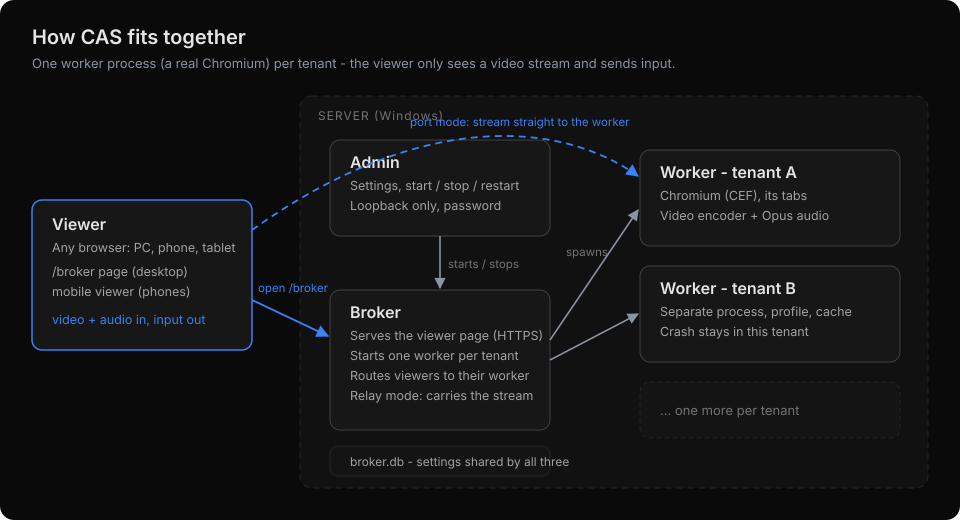
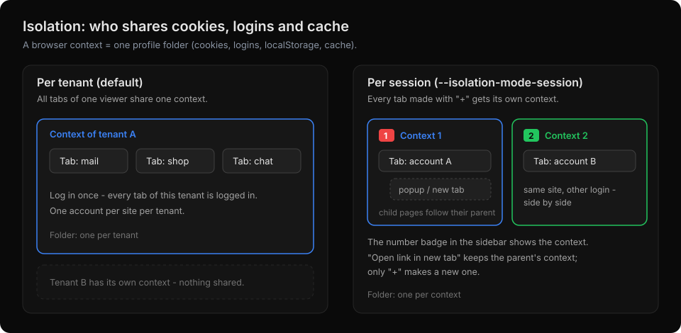
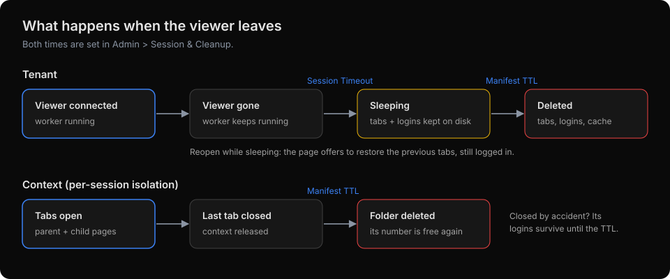
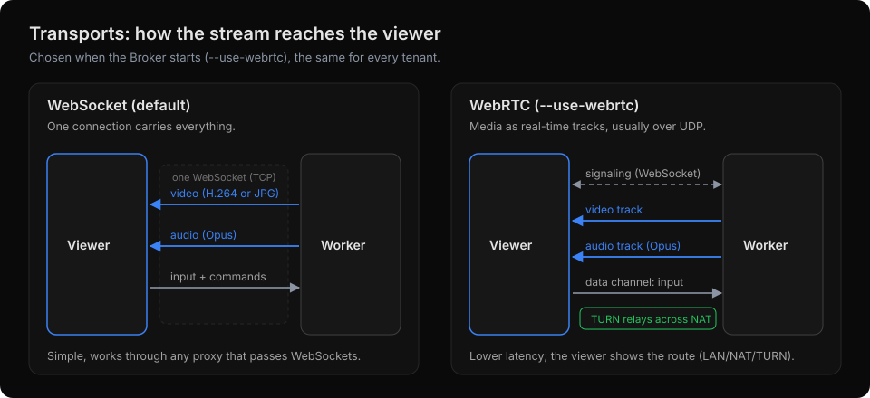
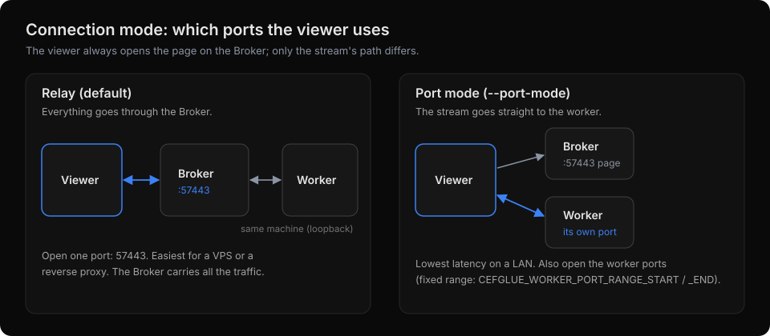

# How CAS works

CAS (CEF as Service) runs real Chromium browsers on a Windows server and streams them to any
browser - PC, phone or tablet. The viewer only receives video and audio and sends input back;
cookies, logins and the pages themselves stay on the server.

- [The three processes](#the-three-processes)
- [Tenants](#tenants)
- [Isolation: per tenant or per session](#isolation-per-tenant-or-per-session)
- [When the viewer leaves](#when-the-viewer-leaves)
- [Transports: WebSocket or WebRTC](#transports-websocket-or-webrtc)
- [Connection mode: relay or port](#connection-mode-relay-or-port)
- [Tunnels and reverse proxies](#tunnels-and-reverse-proxies)
- [Where data lives](#where-data-lives)

## The three processes

| Process | What it does |
|---|---|
| **Admin** (`Xilium.CefGlue.Broker.Admin.exe`) | The control panel: settings, start / stop / restart, live workers. Loopback only, password protected. Start here. |
| **Broker** (`Xilium.CefGlue.Broker.exe`) | Serves the viewer page over HTTPS, starts one worker per tenant, and routes each viewer to its worker. In relay mode it also carries the stream. |
| **Worker** (`Xilium.CefGlue.Headless.Service.exe`) | One per tenant: a real Chromium (CEF) with that tenant's tabs, the video encoder and Opus audio. |

All three read the same settings database (`broker.db`), so a setting saved in Admin is what the
Broker and every new worker use.

## Tenants

A **tenant** is one viewer: the browser that opened the `/broker` page. The page keeps a key in
the browser's local storage, and the Broker gives every key its own worker process.

- **Separate processes.** Tenants share nothing: not the browser profile, not the cache, not the
  process. A crash in one tenant's worker doesn't touch the others.
- **Reconnects.** Reloading the page, a dropped network or a Broker restart reconnects to the same
  tenant. If its worker is gone, the Broker starts a new one and reopens the saved tabs.
- **One viewer at a time.** Opening the same tenant in a second browser tab moves the stream there;
  the first tab offers "Open here" to take it back.

## Isolation: per tenant or per session

A **browser context** is one browser profile: cookies, logins, local storage and cache. The
isolation mode decides how many a tenant gets.

**Per tenant (default).** All tabs of a tenant share one context, like tabs in one Chrome window:
log in once and every tab is logged in. One account per site per tenant.

**Per session (`--isolation-mode-session`).** Every tab created with **+** gets its own context, so
the same site can be open with different accounts side by side. The number badge in the sidebar
shows which context a tab belongs to.

- Pages a tab opens itself - popups, `target="_blank"` links, *Open link in new tab*, a link dragged
  onto the sidebar or **+** - stay in that tab's context and get the same badge. That's what keeps
  sign-in popups (OAuth) working.
- Only **+** creates a new context.

The mode is fixed while the Broker runs. **Switching modes wipes every tenant's cache and saved
tabs** (the two modes store profiles differently); open viewers are told and reload onto a fresh tab.
Admin shows a notice after a switch.

## When the viewer leaves

Two times, both in **Admin > Session & Cleanup**:

| Setting | What happens |
|---|---|
| **Session Timeout** | How long a worker keeps running with no viewer. After that it stops (sleeps), but its tabs and logins stay on disk. |
| **Manifest TTL** | How long a sleeping tenant's tabs and logins are kept before they're deleted. |

Opening the page again while the tenant is sleeping offers to restore the previous tabs, still
logged in.

In per-session isolation the same TTL applies to each context: when the **last** tab of a context
closes (the parent and all its child pages), the context is released, and its folder is deleted
once it has been unused for the Manifest TTL. A tab closed by accident keeps its logins until then.

## Transports: WebSocket or WebRTC

Chosen when the Broker starts, the same for every tenant:

| | WebSocket (default) | WebRTC (`--use-webrtc`) |
|---|---|---|
| Video | H.264 (OpenH264), VP9 or JPG frames | video track (OpenH264 or VP9) |
| Audio | Opus | Opus audio track |
| Input | same connection | data channel |
| Network | one TCP connection; passes any proxy that supports WebSockets | usually UDP; needs a TURN server across NATs. The viewer shows the route: LAN, NAT or TURN |
| Good for | simplicity, restrictive networks | lowest latency |

VP9 is included; OpenH264 is a one-click download from Cisco in Admin (it can't be bundled). Without a video encoder,
WebSocket sessions use JPG frames.

**TURN for WebRTC across NATs.** On a LAN, WebRTC connects directly. A viewer behind another NAT
(a phone on mobile data, another office) needs a TURN server to relay the media. Add it in
**Admin > Transport > WebRTC ICE Servers**: a STUN entry plus TURN entries (UDP, TCP and TLS on 443
for strict networks). Tested with the free tier of [Metered.ca](https://www.metered.ca/) (a phone on
mobile data relayed through it) and with a self-hosted [coturn](https://github.com/coturn/coturn).
Any standard TURN server works the same way; use your own account or server and credentials. The viewer's Route indicator shows **TURN** when the media is relayed.

## Connection mode: relay or port

The viewer always opens the page on the Broker (port **57443**). The connection mode decides the
stream's path:

| | Relay (default) | Port (`--port-mode`) |
|---|---|---|
| Stream path | viewer → Broker → worker (same machine) | viewer → worker directly |
| Ports to open | **57443** only | 57443 **and** the worker ports - set a fixed range with `CEFGLUE_WORKER_PORT_RANGE_START` / `_END` |
| Good for | a VPS, a reverse proxy, the simplest firewall | the lowest latency on a LAN |

With WebRTC, the media itself goes over UDP in both modes; the connection mode then only affects the
signaling. See the README's [Ports](../README.md#ports) table for every port.

## Tunnels and reverse proxies

To reach CAS from outside your network without opening ports, put a tunnel (e.g. Cloudflare
Tunnel) or a reverse proxy (Caddy, Nginx) in front of the Broker. It gives viewers a real domain
with a real HTTPS certificate.

Both setups below are tested with Cloudflare Tunnel:

| | A: tunnel to HTTPS (simplest) | B: tunnel / proxy to plain HTTP |
|---|---|---|
| Service URL | **`https://localhost:57443`** | **`http://localhost:57400`** |
| CAS flag | none | **`--no-selfsigned-https`** |
| Certificate | CAS's self-signed one; if the tunnel reports a certificate error, turn on **No TLS Verify** | none needed between tunnel and CAS |
| LAN viewers | keep `https://<server IP>:57443` | lose 57443 (the self-signed listener is off) |

Without `--no-selfsigned-https`, pages opened on 57400 are redirected to `https://<host>:57443`, a
port the tunnel doesn't carry - so B needs the flag.

For both:

- Use **relay** mode (the default) - in port mode the viewer connects to each worker's own port,
  which a tunnel doesn't forward. (A VPS with a public IP and **no** tunnel can use port mode, once
  the worker port range is open in its firewall.)
- **WebSocket** transport works through the tunnel. **WebRTC** media is UDP and doesn't go through
  an HTTP tunnel: add a TURN server (see [TURN for WebRTC](#transports-websocket-or-webrtc)), or use
  WebSocket.
- Viewers open `https://cas.example.com/broker` (your public hostname).

A reverse proxy (Caddy, Nginx) with its own certificate works like B.

Admin (57402) stays on the server - never expose it.

## Where data lives

Everything CAS writes at runtime is under `C:\ProgramData\CefGlue\`:

| Path | What |
|---|---|
| `broker.db` | All settings and the tenant list |
| `cache\` | Browser profiles: one per tenant, or one per context in per-session isolation |
| `logs\` | Error and Chromium logs |
| `recordings\` | Session recordings waiting to be downloaded |

Deleting that folder (with CAS stopped) gives a completely fresh start.
